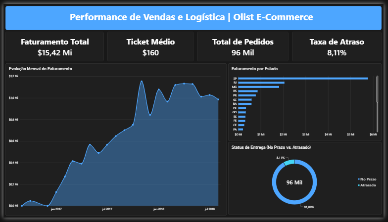
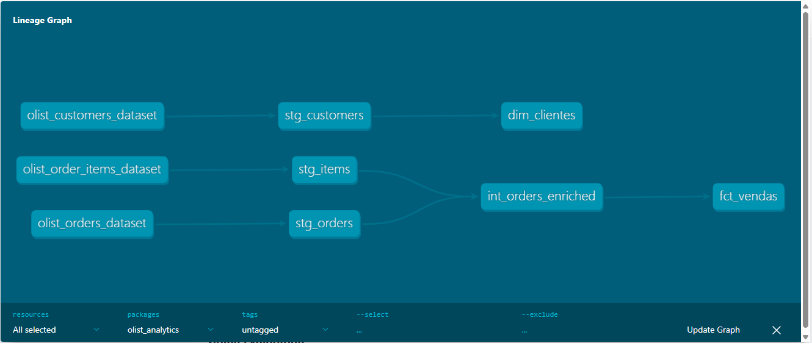

# 🛒 Olist E-Commerce Analytics Pipeline (SQL + dbt + Power BI)

Pipeline completo de **Analytics Engineering** e **Business Intelligence** construído para transformar dados brutos do e-commerce brasileiro (Olist) em um modelo dimensional (**Star Schema**) e entregar indicadores executivos para tomada de decisão.

## 📊 Visualização e Insights (Power BI)

As tabelas finais (`fct_vendas` e `dim_clientes`) foram conectadas ao **Power BI** utilizando medidas DAX para acompanhamento dos principais KPIs:
* **Faturamento Total:** $ 15,42 Milhões em 96 mil pedidos entregues.
* **Ticket Médio:** $ 160,00 por pedido.
* **Eficiência Logística:** Taxa de atraso de 8,11% nas entregas.
* **Sazonalidade e Geografia:** Forte crescimento mensal com pico na Black Friday (Nov/2017) e maior concentração de receita em SP, RJ e MG.

## 🏗️ Arquitetura e Linhagem de Dados (Lineage Graph)

O projeto segue a arquitetura moderna de modelagem em camadas:
* **Seeds (Raw):** Ingestão dos datasets brutos de pedidos, itens e clientes no DuckDB.
* **Staging (`stg_`):** Limpeza inicial, padronização de nomenclatura, tipagem de dados (`TIMESTAMP`, `DOUBLE`) e queries modulares com CTEs.
* **Intermediate (`int_`):** Cruzamento entre pedidos e itens (`JOIN`), agregação financeira e criação da regra de negócio para identificação automática de atrasos na entrega.
* **Marts (`fct_` e dim_):** Modelagem dimensional final (`fct_vendas` e `dim_clientes`) materializada e exportada para consumo no BI.

## 🛡️ Qualidade de Dados (Data Quality)

Foram implementados testes automatizados nativos do **dbt** (`unique` e `not_null`) nas chaves primárias e métricas críticas das tabelas finais, garantindo a integridade referencial antes da entrega para visualização.

## 🛠️ Tecnologias Utilizadas

* **SQL & DuckDB:** Transformação de dados e Data Warehouse analítico local.
* **dbt-core:** Orquestração de modelos, testes de qualidade e documentação de linhagem.
* **Power BI & DAX:** Modelagem estrela, medidas calculadas e visualização executiva.
